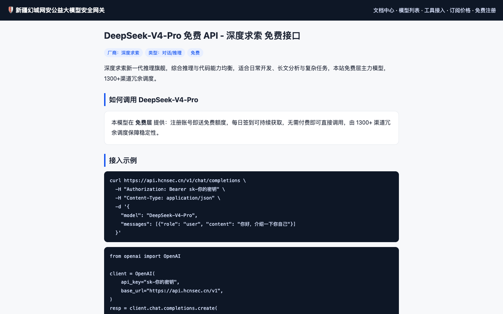
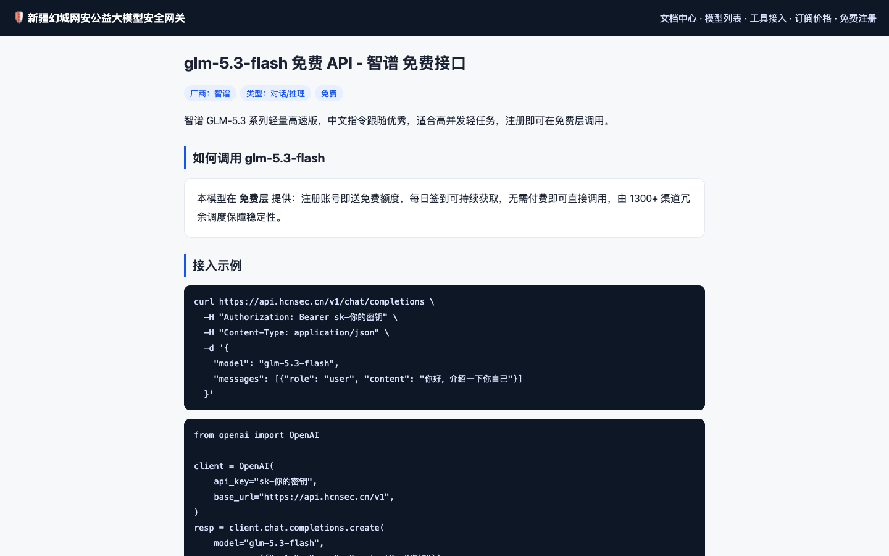
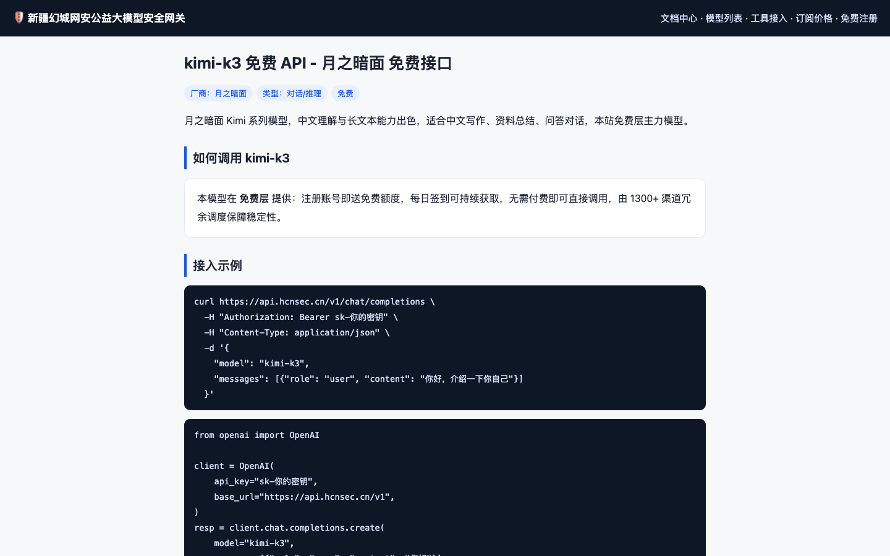

# HC 大模型网关指南：DeepSeek、GLM、Kimi 免费层与 SVIP 怎么选

HC 大模型网关把 DeepSeek、GLM、Kimi 等国产模型接入做得非常直接：统一 OpenAI 兼容地址、现成代码示例、免费层与订阅升级路径。它最适合作为**零成本起步、后续按需求升级**的模型入口。

[进入 HC 大模型网关](https://api.hcnsec.cn/sign-up?aff=aLyp)

## 三条模型路线怎么选

DeepSeek 路线适合代码、推理和长文分析；GLM Flash 适合中文轻任务和高频请求；Kimi 适合资料整理、写作与长文本。三者使用相同的 Base URL，只需更换模型 ID，适合在一个客户端中快速切换。

## 免费层先解决什么问题

免费层最适合完成四件事：确认客户端能连接、学习 Key 管理、比较不同模型、跑通日志。注册后领取页面提供的额度，创建免费分组 Key，从一个短请求开始。只有日常任务持续触碰速度或额度边界，才需要查看 SVIP。

## SVIP 的购买逻辑

SVIP 不是第一次接入的必选项。先连续使用几天，记录每天调用次数、繁忙时段和等待时间。如果免费层已经满足写作、代码或聊天需求，继续使用即可；如果稳定任务经常受额度影响，再进入订阅页面选择当时档位。

充值/订阅流程为：注册登录、打开钱包或订阅页、选择页面列出的套餐和支付方式、付款后创建对应分组的新 Key。套餐权益应使用新 Key，便于和免费层分开统计。

## DeepSeek 接入示例

接口地址为 `https://api.hcnsec.cn/v1`，模型页给出 curl 与 Python 示例。客户端选择 OpenAI compatible，填写 Key 和 `DeepSeek-V4-Pro` 等精确模型 ID 即可。

## 适合替代哪些服务

对于中文写作、代码辅助和日常自动化，HC 可以替代需要分别注册的多个国产模型接口。它的文档覆盖常见客户端与编程工具，适合刚开始接 API 的用户，也适合作为已有工作流的备用路线。

## 成本控制建议

免费 Key、订阅 Key 分开；每个工具再拆独立 Key。先用 GLM 等轻量模型处理日常任务，复杂代码与分析再切 DeepSeek；长文场景使用 Kimi。模型按任务分工，比所有请求都用同一高阶模型更省。

## FAQ

### HC 可以直接接 OpenAI SDK 吗？
可以使用 OpenAI 兼容 Base URL，替换 Key 和模型 ID。

### 什么时候需要购买 SVIP？
当免费层连续多天影响固定任务效率时，再按控制台套餐升级。

### Codex 或代码客户端怎么用？
选择支持自定义 OpenAI 兼容地址的配置，使用独立 Key 和目标模型。

[注册 HC，从免费模型开始建立工作流](https://api.hcnsec.cn/sign-up?aff=aLyp)
